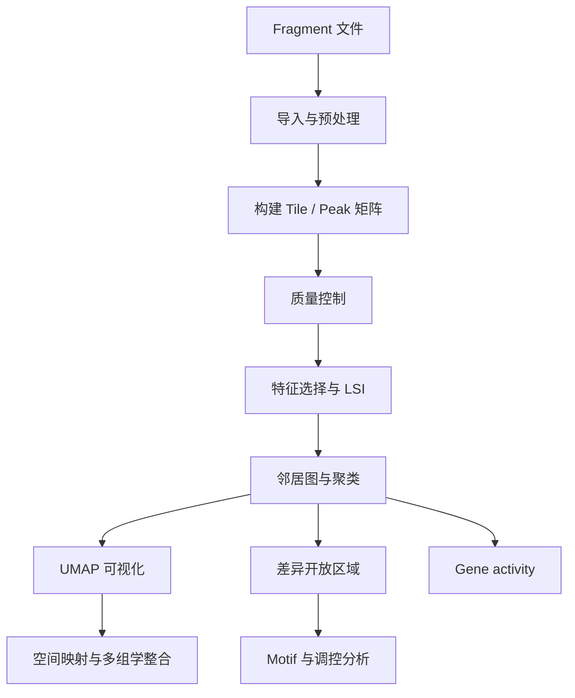

# SnapATAC2：单细胞与空间 ATAC-seq 分析

基于 Python 的染色质可及性分析流程，涵盖数据预处理、质量控制、降维聚类、差异开放区域分析，以及空间 ATAC-seq 与转录组联合分析。

## 1. 项目简介

[SnapATAC2](https://github.com/scverse/SnapATAC2) 是一个用于单细胞表观基因组数据分析的 Python 工具，支持大规模 ATAC-seq 数据处理，并可与 Scanpy、AnnData 等工具协同使用。

主要功能：

- Fragment 导入与 Tile / Peak 矩阵构建
- 细胞质量控制与特征选择
- TF-IDF、LSI 降维及 Leiden 聚类
- 差异开放区域（DARs）分析
- Motif 富集与调控分析
- Gene activity 分析
- 空间 ATAC-seq 可视化
- 与 RNA-seq / 空间转录组联合分析

## 2. 环境配置

截至 2026 年 10 月，本文以 SnapATAC2 **2.10.0** 为目标版本。

```bash
conda create -n snapatac2 python=3.12 -y
conda activate snapatac2

pip install snapatac2==2.10.0
pip install scanpy
```

验证安装：

```python
import snapatac2 as snap
import scanpy as sc

print(snap.__version__)
print(sc.__version__)
```

建议正式项目使用独立环境，并记录完整依赖版本。

## 3. 数据准备

推荐目录结构：

```text
project/
├── reference/
│   ├── genome.fa
│   ├── genome.fa.fai
│   └── genes.gtf
├── data/
│   └── fragments.tsv.gz
├── metadata/
│   └── spatial_coordinates.csv
├── scripts/
└── results/
    ├── h5ad/
    ├── figures/
    └── tables/
```

主要输入：

| 文件 | 用途 |
|---|---|
| `fragments.tsv.gz` | ATAC-seq 片段坐标与 barcode |
| `genome.fa` | 参考基因组 |
| `genes.gtf` | 基因注释 |
| `spatial_coordinates.csv` | 空间 barcode 与组织坐标 |
| `rna.h5ad` | 转录组表达矩阵 |

自定义参考基因组需要确保 FASTA、GTF 和 fragment 文件使用一致的参考版本及染色体命名。

## 4. 核心分析流程



### 4.1 导入数据

```python
import snapatac2 as snap

adata = snap.pp.import_data(
    "data/fragments.tsv.gz",
    chrom_sizes="reference/chrom.sizes",
    file="results/h5ad/atac.h5ad",
)
```

`chrom.sizes` 可根据参考基因组的 FASTA 索引生成。实际运行前，应根据 2.10.0 的官方 API 核对输入格式及函数参数。

### 4.2 质量控制与特征矩阵

质量控制通常关注：

- 每个细胞的片段数
- TSS enrichment
- FRiP
- 片段长度分布
- 双细胞及低质量细胞

随后根据分析目的构建 Tile 或 Peak 矩阵。Tile 适合初始降维，Peak 更适合开放区域及调控分析。

### 4.3 降维与聚类

SnapATAC2 的典型分析步骤包括特征选择、LSI 或其他低维表示、邻居图构建、Leiden 聚类和 UMAP 可视化。

```python
# 分析框架示意；请按 2.10.0 API 完成参数配置
snap.pp.select_features(adata)
snap.tl.spectral(adata)
```

完成降维后，需要根据实际生成的嵌入名称构建邻居图、执行聚类并绘图。

聚类结果应结合 QC、差异开放区域、基因活性和已知细胞标记进行解释，避免将测序深度或批次效应误判为细胞类型差异。

### 4.4 差异开放区域与调控分析

分析目标包括：

1. 识别不同细胞群体的差异开放区域。
2. 对开放区域进行基因组注释。
3. 进行 motif 富集分析。
4. 结合 Gene activity 与 RNA 表达推断潜在调控机制。

Motif 富集只能提供潜在转录因子结合的线索，不能单独证明转录因子的实际结合或调控方向。

## 5. 空间 ATAC-seq 分析

将空间坐标与 ATAC 对象中的 barcode 对应，并保存到 `adata.obsm["spatial"]`。

```python
import pandas as pd
import numpy as np

coords = pd.read_csv(
    "metadata/spatial_coordinates.csv"
).drop_duplicates("barcode").set_index("barcode")

common = adata.obs_names.intersection(coords.index)

adata = adata[common].copy()
coords = coords.loc[adata.obs_names]

adata.obsm["spatial"] = coords[
    ["x", "y"]
].to_numpy(dtype=float)
```

之后可以将聚类标签映射至组织坐标，分析不同细胞群体和开放染色质特征的空间分布。

注意：应先验证 barcode 匹配率、坐标体系和图像缩放关系，再进行空间可视化。

## 6. 与转录组 h5ad 联合分析

读取 RNA 数据：

```python
import scanpy as sc

adata_rna = sc.read_h5ad(
    "results/h5ad/rna.h5ad"
)
```

联合分析需要先判断数据类型：

- **同一细胞的 ATAC + RNA：** 可基于匹配 barcode 进行多组学整合。
- **同一组织的空间 ATAC + RNA：** 需要核对坐标体系、spot 对应关系及组织配准。
- **独立的 scATAC + scRNA：** 可利用 Gene activity、共同细胞类型或跨模态表示建立联系。

推荐重点分析染色质开放程度、基因活性与 RNA 表达之间的一致性，并寻找具有空间特异性的调控区域。

## 7. 结果输出

建议保存：

```text
results/
├── h5ad/
│   └── atac_processed.h5ad
├── figures/
│   ├── umap_clusters.png
│   └── spatial_clusters.png
└── tables/
    ├── cell_metadata.csv
    ├── differential_regions.csv
    └── motif_enrichment.csv
```

## 8. 参考资料

- [SnapATAC2 GitHub](https://github.com/scverse/SnapATAC2)
- [SnapATAC2 官方文档](https://snapatac2.scverse.org/)
- [PyPI 版本与安装信息](https://pypi.org/project/snapatac2/)

## 总结

SnapATAC2 可以构建从 ATAC-seq 数据预处理、降维聚类，到差异开放区域与调控分析的完整框架。结合空间坐标及转录组数据，还可以进一步研究染色质开放特征与基因表达的空间关联。

对于自定义参考基因组和空间多组学项目，建议将数据预处理、ATAC 分析、空间映射和跨模态整合拆分为独立模块，以便验证结果并保证分析可复现。